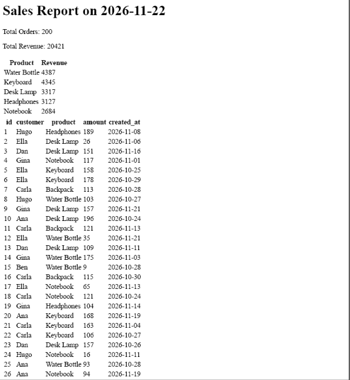

# PDF Report Generator

An API that runs on express, sqlite and Playwright that makes a report from the database to a compact pdf report.

## Dataset

An example dataset that is seeded in `seed.js` that simulates a little shop that has 200 orders.

## Run it

1. Install Node.js 22.13 or newer.
2. `npm install`
3. `npx playwright install chromium`
4. `npm run seed` (creates report.db with 200 orders. Safe to run twice.)
5. `npm start` (the API runs on http://localhost:3000)

## API

| Method | Route | What it does | Success | Errors |
| --- | --- | --- | --- | --- |
| GET | /health | Health check | 200 | |
| POST | /reports | Generates a report, or returns today's existing one | 201 new, 200 existing | 500 |
| GET | /reports/:id | The report record and its link | 200 | 404 |
| GET | /reports/:id/file | Downloads the PDF | 200 | 404 |

Sending `{ "force": true }` in the body of POST /reports always makes a new report.

## Try it

`time curl -i -X POST http://localhost:3000/reports`

`curl -o my-report.pdf http://localhost:3000/reports/1/file`

Example output:
 
 
time curl -i -X POST http://localhost:3000/reports   
HTTP/1.1 200 OK  
X-Powered-By: Express  
Content-Type: application/json; charset=utf-8 
Content-Length: 33 
ETag: W/"21-jMBvx/J70f9lNc+53LFVjfEJfus" 
Date: Sun, 22 Nov 2026 11:04:00 GMT 
Connection: keep-alive 
Keep-Alive: timeout=5 
 
{"id":4,"file":"/reports/4/file"} 
real    0m1.258s 
user    0m0.075s 
sys     0m0.170s  

## Aggregation SQL

This gets the total amount of orders  
`const totalOrders = db.prepare("SELECT COUNT(*) AS total FROM orders").get().total;`
 
This gets the total Revenue 
`const totalRevenue = db.prepare("SELECT ROUND(SUM(amount), 2) AS total FROM orders").get().total;`
 
This gets the top 5 Products based on the report 
`const topProducts = db.prepare("SELECT product, ROUND(SUM(amount), 2) AS revenue FROM orders GROUP BY product ORDER BY revenue DESC LIMIT 5").all();`
 
This gets how many orders the store gets everyday 
`const ordersPerDay = db.prepare("SELECT created_at, COUNT(*) AS orders FROM orders WHERE created_at >= date('now', '-6 days') GROUP BY created_at ORDER BY created_at").all();`

## Sample report

## When would I move this out of the request?

I will move this out when it is too much request to download the pdf, the server will crash from request overload.

## Why generating twice makes one report

It prevents that 2 request will equal to 2 files and it will now only generate 1 file even with many request. The missing check can be devastating as everything is needed to be documented and a missing check can be brutal. Its like forgetting a customer's change after doing the transaction, you've never wanted to ask the customer itself for their change and it has been a possibility that you might give the customer more change than they expected. 